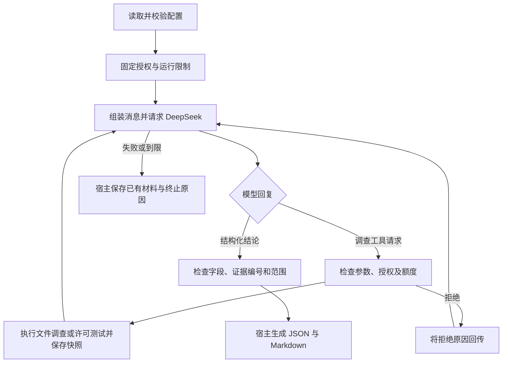

# 自行实现 Harness 的根因分析 Agent

一个独立运行的 Python Agent，用受控小型 Python 材料学习根因分析与 Harness Engineering。需求见 [规格 #1](https://github.com/Holly-Wang/root-cause-agent/issues/1)，当前实现对应 [最小闭环 #2](https://github.com/Holly-Wang/root-cause-agent/issues/2)、[文件调查 #3](https://github.com/Holly-Wang/root-cause-agent/issues/3)和[许可测试 #4](https://github.com/Holly-Wang/root-cause-agent/issues/4)。

DeepSeek 只提供推理。请求组装、上下文、回复解析、工具调度、授权与额度检查、证据快照、引用校验和报告生成都由本项目程序实现；运行时只使用 Python 标准库，没有 Agent 框架。

## 开发文档

- [八项开发任务](docs/development-tasks.md)：任务总览、依赖关系及完整验收清单。
- [领域术语](GLOSSARY.md)与[架构决策](docs/adr/)：项目概念和已确认的设计取舍。

## 快速运行

需要 macOS/Linux 和 Python 3.11+，在仓库根目录运行，无需安装运行依赖。先在同一个终端提供密钥（以下是 zsh 的隐藏输入方式）：

```zsh
read -rs 'DEEPSEEK_API_KEY?粘贴 DeepSeek API Key（输入隐藏）：'
export DEEPSEEK_API_KEY
```

不要将实际密钥填写到配置或仓库中。若之前已在当前终端导出变量，可直接运行：

```bash
python3 -m rca_agent --config examples/average/config.json --output runs/average
```

程序显示进度，将 `run.json` 和 `report.md` 保存到指定目录。退出码：`0` 表示形成有效报告，`1` 表示分析未完成，`2` 表示配置或报告写入错误。报告输出目录应在授权材料目录之外。`runs/` 不进入 Git。

本次开发的模拟回归和类型检查已通过；真实 DeepSeek 验证尚待在配置了密钥的终端执行。模拟结果不能替代真实模型验收。

## 主要流程



- 模型使用原生 `list_directory`、`search_text`、`read_file`、`run_test` 和 `ask_user` 工具调用。程序解析参数并执行；模型选择调查动作、许可测试编号及何时请求补充。
- 工具结果中的证据编号、实际文本和行范围回传给模型，模型可据此继续调查。
- 初始材料标明用户来源，不视作本次测试已经验证的事实。
- 每个候选原因必须引用实际取得的文件证据；引用有效不代表候选原因正确。信息不足时可以没有候选原因，须明确尚未找到/确认根因，并保留信息缺口和合理问题。报告另保留支持与反驳证据、实际验证、未确认事项、修复建议和下一步。
- JSON 保存配置快照、模型名称、通信来源、模型/工具尝试计数、公开事件、实际证据与结论。Markdown 是宿主基于有效结构化结果生成的阅读版本。

## 文件调查工具

| 工具 | 参数 | 取得的材料 |
| --- | --- | --- |
| `list_directory` | `path` | 递归取得文件和子目录的相对路径与类型，不读取文件内容 |
| `search_text` | `path`、`query` | 在文件或子树中进行大小写敏感的行内字面匹配，保留路径、行号和完整行文本 |
| `read_file` | `path`、`start_line`、`end_line` | 读取实际文件片段，保留文件来源和有效行范围 |

路径相对固定授权根解析，绝对路径同样检查实际目标；空白路径拒绝，根目录使用 `.`。搜索不支持正则和跨行匹配；查询必须非空，单个空格也是合法字面查询。

一次正常调查可以是 `list_directory(".")` → `search_text(".", "sum")` → `read_file("average.py", 1, 2)`，也可以先读已知文件或重复搜索。程序没有预设调查阶段或案例答案。

直接请求授权外目标时，整次工具请求拒绝。递归遇到指向范围外的 `external` 链接时，记录其相对路径及 `permission_denied` 原因，跳过目标并继续正常项；目录符号链接不递归，断链和无法解析的链接另记原因。授权范围内的文件链接再次核对实际目标后才读取。

目录与搜索结果保存为 `directory` / `search` 证据，`content` 是当次保留结果的 JSON 快照，记录请求路径、解析范围和查询。它们只按证据编号引用，不制造跨文件连续行号；候选原因仍须引用一份有效 `file` 片段。Markdown 区分用户初始材料、宿主目录查看、宿主搜索与文件片段，原材料变化不会重读或改写旧快照。拒绝与故障同时记录配对调用编号、错误反馈及公开事件，已有证据保持可核对。

### 结果完整性

- `scan_complete`：是否遍历到本次范围末尾；因资源限制提前结束为 `false`。它不表示所有子项均已成功处理。
- `stop_reason`：提前停止的原因，如 `scan_limit`、`read_limit`、`results_limit`、`feedback_limit`；遍历完成为 `null`。
- `results_truncated`：已找到但未保留的结果是否存在。仅因达到条目数上限而停止、且已找到结果全部保留时，它仍为 `false`，未扫描部分是否有匹配不能猜测。
- `scanned_entries`、`read_bytes`、`returned_count`：本次实际扫描、读取和保留数量，不是未知的目录或匹配总量。
- `skipped_count`、`skipped_reasons`、`skipped`、`skipped_details_omitted`：跳过计数、按原因汇总、有界详情和详情省略标记；详情最多占反馈预算四分之一。

完整扫描、无跳过项时的空匹配是有效观察。扫描未完成或有跳过项时，零命中只表示已处理部分没有保留匹配。目录列表不能证明文件内容已搜索。到达限额即停止，不额外扫描以确认总量；即使恰好处理最后一项，也可能保守地报告未确认扫描完整。

搜索不把超长行的片段当作完整行证据：跳过长行并记录 `line_limit`，寻找行尾继续消耗搜索字节额度；到限即停止。子文件不可读或非 UTF-8 时跳过并记录，非 UTF-8 文件先前暂存的匹配移除；直接请求不可读的目标则返回工具错误，不以空匹配掩盖故障。

## 配置及限制

配置是 JSON，包含 `question`、`initial_materials`（文本列表）、`authorized_dir`、`model`、`limits` 和可选的 `permitted_tests`。相对授权目录以配置文件所在目录为基准；启动后固定解析出的实际目录。文件调查拒绝路径越界及指向范围外的符号链接。

| 限制 | 默认值 | 行为 |
| --- | --- | --- |
| `max_model_calls` | 8 | 每次模型请求尝试计数，到限不发起新操作 |
| `max_tool_calls` | 12 | 所有工具请求，包括非法和被拒绝的请求，均计数 |
| `total_seconds` | 120 | 固定总期限；模型等待和许可测试执行期间响应，活动操作清理最多额外两秒 |
| `max_read_bytes` | 8192 | 单次片段的 UTF-8 字节上限，超限拒绝、不保存部分证据 |
| `max_scan_entries` | 1000 | 每次目录/搜索扫描条目数，目录、过滤及跳过项均计数 |
| `max_search_bytes` | 262144 | 每次搜索读取的总字节，包含未命中和跳过长行时的读取 |
| `max_line_bytes` | 4096 | 搜索单行字节上限，包含换行符 |
| `max_results` | 100 | 每次目录条目或搜索匹配数量，达到即停止 |
| `max_tool_feedback_bytes` | 16384 | 所有工具实际 tool content 的 UTF-8 字节上限，含证据包装和 JSON 转义 |
| `max_test_output_bytes` | 8192 | 单次许可测试合并 stdout/stderr 的保留字节上限，超出部分丢弃并标明截断 |
| `max_context_bytes` | 262144（256 KiB） | 每份完整 provider 请求 JSON 的 UTF-8 最大字节数，发送和新工具派发前检查 |
| `max_evidence_bytes` | 131072（128 KiB） | 已保存 Evidence 记录的累计 JSON UTF-8 最大字节数，逐条准入 |
| `max_supplement_bytes` | 8192 | 单次补充 JSON 对象的稳定 UTF-8 字节上限；CLI 另按此值限制一行原始输入 |
| `max_supplement_attempts` | 3 | 每次 `ask_user` 最多读取的答复次数，含无效答复；最后一次合法答复仍可准入 |

所有数量限额必须为正整数，`max_tool_feedback_bytes` 至少为 2048，以容纳最小状态或错误。目录/搜索边扫描边保留可完整放入反馈的结果，为后续状态和计数字位预留空间，可能早于字节上限停止；不全量收集或排序后再裁剪。文件片段包装后仍超限时整次拒绝，不保存缺失内容的证据。错误反馈也遵守字节预算。查询范围本身过大、无法放入最小状态时返回 `feedback_limit`。

单次读取最多 200 行，定位片段最多扫描 256 KiB。模型回复最多请求 4096 tokens，HTTP 响应最多读取 1 MiB。默认值是初版实现选择，可在后续任务调整，不代表规格预先固定的数值。

到限后已有文件证据仍保存，不额外请求模型生成结束报告。最后一个允许的模型请求可以交付有效结论，但其后不能启动新工具。单次逻辑模型请求发生已标记可重试的通信错误时，在总额度和时间允许的情况下最多重试一次；当前真实通信仅将请求超时标为可重试，其他错误维持失败收尾。通信成功后重置该请求的重试次数，不重置总调用计数或报告修正次数。结构化报告字段或证据引用无效时，宿主追加具体反馈，整个分析最多给一次修正机会，仍无效则失败并保留证据。

DeepSeek 接口固定为 `https://api.deepseek.com/chat/completions`，使用非流式 JSON 输出并显式关闭 thinking mode，避免将模型推理内容混入可核对的证据。模型名称由配置选择，样例为 `deepseek-flash`。接口依据：[工具调用与 thinking](https://api-docs.deepseek.com/guides/thinking_mode/)、[JSON 输出](https://api-docs.deepseek.com/guides/json_mode/)。

## 许可测试与进程生命周期（T3）

启动配置可增加以下映射；省略时不许可任何测试。将示例程序路径替换为本机已存在、可执行的 Python 绝对路径，将参数替换为本次明确许可的可信测试：

```json
{
  "permitted_tests": {
    "average-check": {
      "command": ["/absolute/path/to/python3", "check_average.py"],
      "timeout_seconds": 5,
      "assertion_failure_exit_codes": [10]
    }
  }
}
```

程序启动时校验并固定映射：编号为 1–128 个 ASCII 字母、数字、下划线或连字符；程序必须是可执行普通文件的绝对路径，启动时解析符号链接检查实际目标，执行仍保留原调用路径以维持 Python 虚拟环境语义；参数必须为无 NUL 的 UTF-8 字符串，时限为有限正数，专用退出码为不重复的 1–255 整数。参数按字面固定，不使用 shell、不展开变量或拼接模型文字；通用参数没有文件路径语义，可信测试及其参数引用的材料由授权者事先核对。工作目录固定为授权目录，标准输入关闭。运行中修改原配置对象不会改变许可；不防御可信程序、符号链接或材料被并发替换。

模型初始收到可选编号，只能调用 `run_test({"test_id": "average-check"})`。未许可编号、额外命令/参数或非法 JSON 被拒绝，不启动进程、不制造退出码，错误反馈及配对调用编号写入事件。测试实际启动失败则保存 `test` 证据，保留 `start_errno`，但 `exit_code` 和 `signal` 均为 `null`。

每份测试证据包含 `test_id`、`started`、有限 `output`、`exit_code` / `signal`、`classification`、`classification_basis` 和 `cleanup_status`。退出事实与分类分开：正常退出保留退出码；信号终止保留正整数信号编号而退出码为 `null`；尚未确认直接进程退出时两者也为 `null`。分类为 `passed`、`assertion_failed`、`execution_error`、`timeout` 或 `cancelled`。`classification_basis` 区分 `test_deadline`、`total_deadline` 与 `user_cancelled`。断言失败只依据可信测试已约定的专用退出码；`assertion_failure_exit_codes` 默认空列表，普通非零退出归为执行故障。**不要直接将普通 `python -m unittest` 的退出码 1 声明为断言失败**，因为它也可能代表导入或测试运行错误；若需区分，可信测试入口必须为断言失败和执行错误提供不同退出码。输出中的 “AssertionError” 等文字不作为分类依据。

测试使用独立 POSIX 进程组，由宿主计时，无单独 timer 进程。宿主非阻塞排空合并管道，内存保留受输出限额约束；完整反馈再按 JSON 转义后的字节预算裁剪。非 UTF-8 输出以替换字符保留。`output_truncated` 表示已观察输出因保留或反馈限额被裁剪；`output_complete` 表示是否读到管道 EOF，未读完整时不能推断缺失内容。

测试自身时限到达只产生 `classification=timeout`、`classification_basis=test_deadline` 的测试证据。若进程组清理已确认，且整次运行总期限和调用额度仍允许，宿主将配对的超时工具结果回填模型，允许后续调查并可能以 `completed` 形成报告；报告仍保留测试超时、验证未完成的事实，`completed` 不表示测试通过。宿主不会自动重跑测试，也不重置总期限或额度。整次总期限到达或用户取消则结束运行，不再发起模型或工具；额度耗尽仍沿用 `limits_exhausted`。

即使直接进程退出或管道 EOF，宿主仍独立探测整个进程组。发现残留后代时先发 TERM，约 0.2 秒后仍未退出则发 KILL；清理共用最多两秒宽限，清理期间继续有限排空输出。只有确认组不存在且直接进程已回收才记录 `cleanup_status=confirmed`；否则为 `cleanup_failed`，停止新操作。已有总超时或取消原因时保留该主原因；普通操作清理失败且没有先发生运行停止时以系统失败结束。结果保留实际 `cleanup_seconds` 及是否尝试强杀；运行总耗时照实记录。测试快照和配对 `test_result` 事件可保存为 JSON/Markdown；报告对 `test` 证据只引用编号，不虚构文件行范围。

本功能没有操作系统沙箱。只运行本次明确许可的可信测试；测试继承宿主环境，可访问宿主文件及网络，许可检查不能隔离这些行为。可信测试及后代必须留在受管进程组；主动逃离进程组不在清理保证内。

## 总期限、取消与统一清理（第十一课，T4 的一部分）

`run_analysis` 接受公共 `CancellationToken`；调用方可从控制线程调用 `cancel()`，第一次请求的单调时钟时间保持不变。启动前已取消时不派发；每次模型/工具派发前及返回后检查停止，停止后晚到的成功结果也不会成为完成报告。CLI 的 Ctrl+C/SIGINT 使用同一令牌，重复 Ctrl+C 不重新开始清理宽限。报告仍写在授权材料目录之外。

```python
from rca_agent import CancellationToken, run_analysis

cancellation = CancellationToken()
# 将 cancellation.cancel 交给调用方的控制线程；config 使用既有配置。
result = run_analysis(config, cancellation=cancellation)
```

通信接口现在是 `ModelTransport.complete(request, control: RunControl)`，第二个参数不再是相对秒数。所有自定义适配器必须配合该控制对象：通过 `checkpoint()` 检查、`remaining` 取得剩余时间，或使用可取消的 `wait(seconds)` 等待；`deadline` 是只读的绝对单调期限。停止会抛出 `RunStopped`，适配器必须先在 `finally` 结束自有通信、确认其线程/任务收尾，再传播停止或返回。不得吞掉停止、重置期限、私自重试或遗留后台请求。任意忽略契约的阻塞 Python 适配器不具备可中断保证，宿主不会通过遗弃线程包装它；适配器构造和同步 `on_event` 回调也应及时返回。原有只接收 `timeout: float` 的适配器需要迁移。

真实 `DeepSeekTransport` 将每次固定地址的 HTTPS 尝试放在独立受管工作进程中，宿主非阻塞传递请求和读取有界反馈，约每 20 ms 检查取消与固定期限。DNS、TLS、请求写入和响应等待都位于该工作进程内；停止后先结束并确认进程组，再返回分析结果，没有遗留请求线程。凭据只继承环境，不写入命令行、报告或日志；服务错误正文丢弃，通信异常仅保留受控错误码。结束本地通信不能证明远端服务器已经停止处理已收到的请求。

许可测试同时观察总期限、取消与测试自身期限。单纯测试自身超时且清理成功可继续调查；总期限或取消则停止运行。活动操作从首次进入清理起只有一个两秒期限，由模型传输和测试共用的清理函数执行；排空输出、TERM、KILL、退出确认及重复 SIGINT 均不叠加新的宽限。主停止原因按总期限与第一次取消请求确立并保持，清理失败不会把它覆盖为普通 `system_failure`。清理期间到达总期限也会阻止后续操作。

`run.json` 与 Markdown 分别保留运行的 `status` / `reason` 和清理事实：`cleanup_status` 为 `not_needed`、`confirmed` 或 `cleanup_failed`；`cleanup` 列表逐项记录操作、进程组、实际清理秒数、状态及强杀尝试，另有对应 `cleanup_result` 事件。顶层 `cleanup_seconds` 累计所有已执行操作的实际清理时间，包含停止前正常完成的操作；单次停止时活动操作的额外清理宽限仍最多两秒。`elapsed_seconds` 包含运行及清理，未确认退出会如实记录。已有文件证据、测试部分输出及原始退出事实都保留，等待清理完成或宽限耗尽后才发送 `finished`。运行终止状态与诊断正确性分别判断。

第十一课实现了模型等待、活动测试、停止原因与清理的协作控制，第十二课已教学结课。运行计时沿用配置验证后的起点；文件读取/扫描仍在操作返回后的调度边界响应，配置读取、操作系统进程创建、信号投递与调度本身不具备硬实时上界。两秒是宿主停止追加等待的清理期限，实际耗时照实保存；OS 无法确认退出时记录失败。上下文规模与累计材料限制见下一节；课程通过和确定性回归通过不等于整个 T4 Issue 或真实模型验收完成。

## 上下文与累计材料准入（第十二课，T4 的一部分）

新增两项配置均为正整数，拒绝布尔值、浮点数、零及负数；省略时采用上表公开默认值。对这两项最大尺寸，**等于上限允许，超过上限拒绝**，无隐含余量。它们不替代单次读取、扫描、反馈和测试输出限制；单次合法仍可能累计超限。

定义稳定序列化 `J(x) = json.dumps(x, ensure_ascii=False, allow_nan=False, sort_keys=True, separators=(",", ":")).encode("utf-8")`，计量单位是字节，JSON 转义和中文 UTF-8 实际字节均计入。

- 上下文尺寸为 `len(J(request))`。`request` 是实际交给 provider 的完整请求对象，含 `model`、全部 system/user/assistant/tool 消息、工具定义及 schema、`response_format`、`thinking`、`max_tokens`、`stream` 等所有字段。内部消息 content 已是字符串时，外层 JSON 对该字符串的再次转义也计入。它是单份宿主请求的字节预算，不是模型 token 窗口或历次请求账单合计，不含 HTTP 头、凭据及宿主与工作进程间的通信包装。
- 累计证据尺寸为 `sum(len(J(asdict(e))) for e in evidence)`，即每条完整 Evidence 记录的字节数之和，**不计列表的方括号或记录间分隔符**；空集合为 0。每条记录含 `id`、`kind`、`source`、`content`、`start_line`、`end_line`（含 `null`），内容内层 JSON 的转义也计入。初始材料、文件、目录、搜索、许可测试使用相同公式；重复保存也另算。这个定义限制保存的证据记录，不是 messages 大小，也不随模型轮次、重试或报告修正重置。

宿主在 `client.complete` 之前检查完整请求，尺寸未准入的请求不增加模型尝试计数。每次新工具派发前也按当前历史检查，包括刚收到的 assistant tool_calls 和同批次已获得的工具反馈；若已超限，不再执行剩余工具。最终有效报告可直接完成，不要求对无需再次发送的最终回复额外预留请求空间。报告校验反馈进入历史后，修正请求仍须准入；通信重试复用同一上下文、次数及绝对期限。`DeepSeekTransport` 使用同一 `J` 生成正文，HTTP 工作进程原样发送；自定义传输也须遵守这项契约，不得再追加字段或改写正文。

初始材料依次准入；工具结果先遵守单次反馈限制，再在追加 Evidence 前检查累计预算。候选记录超限时整条拒绝，保留此前已准入快照，不裁剪、去重、压缩或静默删除；工具操作已经发生的，工具次数仍计入。`resource_limit` 事件只记限额、候选/累计字节、证据种类/编号、配对工具编号及有限来源（最多 256 字符，并标明来源是否截断），不将拒绝原文转存事件。拒绝测试结果时进程已按原规则完成清理，独立的清理记录仍保存。

上下文或材料超限以 `limits_exhausted` 和 `max_context_bytes` / `max_evidence_bytes` 停止新操作；不请求模型生成结束报告。宿主保存已有证据、关键事件、计数、实际耗时及未完成原因，写出 `run.json` 和 Markdown。已确立的 `total_deadline` / `user_cancelled` 保持主原因，资源拒绝与清理事实另外保留。次数耗尽仍使用 `call_limit`，所有被拒绝工具仍消耗原次数预算。`resource_usage.evidence_bytes` 是实际准入的累计字节；`largest_context_bytes` 是所有检查过的请求候选中的最大尺寸，包含被拒绝或尚未发送的候选，不能据此当作已发请求数。

这两项预算不限制 Python 进程全部内存、HTTP 响应、配置文件、事件、报告磁盘占用或序列化临时分配；各自仍沿用已有边界。输入配置本身已在内存，拒绝前也需要测量候选。保存的原证据 20 KiB 即使将来模型历史摘要成 5 KiB，证据仍计 20 KiB；本课没有摘要、任意恢复或额外模型请求来绕过限额。终止状态与诊断正确性仍分别判断。

## 同一运行中补充材料（第十三课，T5）

模型通过 `ask_user({"gap":"缺失的具体材料","question":"合理且明确的问题？"})` 请求补充。这是普通、计数的工具请求；非法提问拒绝且计入工具次数。宿主发出 `waiting_for_user`，等待中不请求模型，总期限继续。合法答复以原 `tool_call_id` 的工具反馈加入原 messages，原证据仍可引用；不递归或重新调用 `run_analysis`。授权目录、许可映射、全部次数/恢复计数、绝对期限和资源预算保持原值，不为答复增加权限。

公共入口新增 `input_provider`。它是人类输入 seam，`InputProvider.receive(request: SupplementRequest, control: RunControl)` 返回下列严格 JSON 对象之一，或 `None` 表示 EOF。`SupplementRequest` 含 `gap`、`question`、`max_bytes`、`error`（上次答复拒绝码，首次为 `None`），可从 `rca_agent` 导入。

| 答复 | 含义 |
| --- | --- |
| `{"kind":"text","text":"实际输入为三项；我本机测试通过。"}` | 非空文本，保存为 `user_supplement`，来源 `user_reply` |
| `{"kind":"file","path":"average.py","start_line":1,"end_line":2}` | 由宿主真实读取片段，沿用文件行数、字节和实际路径/符号链接检查，保存为 `file` |
| `{"kind":"decline"}` | 不补充，希望得到诚实缺口总结；不制造证据 |
| `{"kind":"cancel"}` | 请求整次运行取消，不再发送模型或工具 |

答复不得含额外字段。文件引用不能改授权根；不存在的文件、无效范围、外部路径/符号链接拒绝。没有测试类答复可增加许可或执行命令。拒绝后发出有限的 `input_rejected` 原因，并在同一次等待中再次调用输入方，不询问模型处理无效输入；如需扩大授权，修改配置重新启动。空输入无效，最多尝试 `max_supplement_attempts` 次，耗尽以 `limits_exhausted/max_supplement_attempts` 结束。一次合法补充只消耗已经计数的一个 `ask_user` 工具请求，答复尝试不会伪装成模型/工具调用。

EOF 和显式拒绝都会回填 `ok=true, declined=true`，区分 `eof`、`user_declined`。库调用未提供输入方时立即回填 `input_unavailable`，不会偷偷读取 stdin。模型可在剩余预算内提交缺口报告；这不是强制额外的结束请求。之后的提问仍受原工具/模型次数及期限约束，不承诺用户拒绝后模型必定一次形成报告。

自定义输入 adapter 必须使用传入的同一 `RunControl` 检查取消和期限，等待可用 `control.wait()`；停止先收尾自有等待，再传播 `RunStopped`，不能遗留线程或后台任务。也不能调用模型、重置期限或改写宿主权限/预算。忽略契约的任意阻塞 adapter 没有中断保证，宿主不会用遗弃线程模拟超时。回调和 adapter 构造也应及时返回。控制方仍使用公共 `CancellationToken.cancel()`。

CLI 显示缺口和问题后逐行读取真实 stdin：普通 UTF-8 文本是一份文本答复；以 `{` 或 `[` 开头的行按 JSON 解析，文件引用使用上表 JSON。普通文本需要以 `{` 开头时请使用显式 text JSON 包装。`/decline` 拒绝补充，`/cancel` 或 Ctrl+C 取消，EOF（终端空行处 Ctrl+D）请求缺口总结。空行或非法 JSON 被拒绝，不作 EOF。支持连续多行答复和最后一行无换行的 EOF；每行是一份答复。stdin 用 `select` 和有界 `os.read`，约每 20 ms 检查原期限与取消，不调用阻塞 `input()`，不启动输入线程，也不关闭调用方 stdin。无输入但 stdin 仍打开时，总超时照常结束并保存报告。

单次材料对象按前节 `len(J(answer))` 计量，包含 JSON 包装和转义；CLI 同时限制每行原始 UTF-8 字节（不含换行符）。两者均等于上限允许、超过拒绝；因此普通文本的实际可用内容少于 `max_supplement_bytes`，JSON 包装也占额度。固定控制答复与 EOF 不算材料，但 CLI 原始行仍须有界，极小输入限额下可用 Ctrl+C/EOF。原始行未结束即超限时不继续积累或排空，`size_is_lower_bound=true` 表示记录的是已观察的尺寸下界，不猜测完整行大小。

每次展示的完整 `SupplementRequest` JSON（含拒绝码）和配对反馈分别受 `max_tool_feedback_bytes` 限制。文件补充还受原 `max_read_bytes`、至多 200 行和定位扫描 256 KiB 限制；字节超限以 `max_read_bytes` / `file_scan_bytes` 结束，并如实标记仅知超限下界。补充自身、展示或反馈尺寸超限统一 `limits_exhausted`；拒绝原文不写事件。有效候选再经过原累计 Evidence 和完整 request 准入，超限不重试模型生成报告。已确立的取消/总超时优先，已有证据、等待问题、拒绝原因、计数和实际耗时保存到 run.json / Markdown，报告仍在材料目录之外。

`user_supplement` 与初始材料都属于用户提供、未经本次宿主测试验证；工具反馈额外标记 `provenance=user_provided_unverified`，不会因“我本机测试通过”变成 `test`。真实文件引用只证明宿主读取了该片段。报告 `verification` 不得引用用户陈述作为宿主验证，即使混入文件引用也拒绝；原文件行范围及各类证据引用规则保持不变。

## 明确根因判断的报告格式

结构化结论现在严格要求八个字段：原有 `candidate_causes`、`verification`、`unconfirmed`、`repair_suggestions`、`next_steps`，以及 `root_cause_found`、`information_gaps`、`follow_up_questions`。旧五字段格式不兼容，会显式返回 `invalid_report_fields` 并在原预算内最多修正一次；不补出一个默认 True，也不重写历史报告文件。

- `root_cause_found` 必须为真正的 JSON bool，不接受 0/1 或字符串。False 表示尚未找到或确认根因，`information_gaps`、`follow_up_questions`、`unconfirmed` 必须为非空的非空文本列表；候选可以为空。若仍提供候选，每个仍须有文件支持，不能用用户陈述或目录结果绕过 `missing_file_evidence`。
- True 仅表示模型声明已找到根因，必须有文件支持的候选；阻碍根因判断的 `information_gaps` 必须为空。它不表示宿主证明因果关系、测试通过或诊断正确，Markdown 会明确说明。其他验证或扩展调查的后续问题仍可保留。

合法的无确定根因报告可以直接 `completed`，例如：

```json
{"root_cause_found":false,"information_gaps":["缺少失败调用的实际输入和输出。"],"follow_up_questions":["请提供失败调用的输入、输出及期望值？"],"candidate_causes":[],"verification":[],"unconfirmed":["尚未找到或确认根因。"],"repair_suggestions":[],"next_steps":["取得复现材料后继续调查。"]}
```

宿主校验结构、状态一致性、证据种类及引用范围，不能判断任意自然语言陈述是否真实，也不能证明缺口或问题的实际诊断价值；这些仍需人工与真实模型验收。运行是否完成与根因是否正确分别保存。

## 代码与测试

| 职责 | 位置 |
| --- | --- |
| 配置及固定授权 | `rca_agent/config.py` |
| 通用 HTTP 通信、模型消息协议 | `rca_agent/model.py` |
| 单次固定 HTTPS 请求 | `rca_agent/_http_worker.py` |
| 精确 UTF-8 JSON 序列化 | `rca_agent/serialization.py` |
| 取消令牌、期限与清理记录 | `rca_agent/control.py` |
| 统一进程组清理 | `rca_agent/processes.py` |
| 受限文件读取 | `rca_agent/tools.py` |
| 许可测试与进程组生命周期 | `rca_agent/test_runner.py` |
| 人类答复 interface、校验及可中断 stdin adapter | `rca_agent/supplement.py` |
| 一次分析的循环与基础停止行为 | `rca_agent/runtime.py` |
| 证据、报告校验及报告生成 | `rca_agent/report.py` |
| CLI | `rca_agent/__main__.py` |

公共入口是 `rca_agent.run_analysis(config, transport=..., on_event=..., cancellation=..., input_provider=...)`。测试只替代外部模型通信及人类答复输入，仍使用真实临时文件和进程，从返回状态、证据、报告、事件和实际模型请求观察行为。CLI 输入验收只替代模型，使用真实 stdin 和信号。注入的通信在结果中标为 `injected_transport`；默认真实通信标为 `deepseek`。

```bash
python3 -m unittest tests.test_analysis
```

目录调查的五组公共入口验收使用真实临时目录、文件、符号链接和文件删除，仅模拟模型通信；覆盖不同合法动作选择、参数及授权、有界结果、快照和引用、空结果与故障：

```bash
PYTHONDONTWRITEBYTECODE=1 /Users/wangxu/.local/bin/python3.12 -m unittest tests.test_discovery -v
```

许可测试的五组验收从 `run_analysis` 运行真实受控进程：正常完成、断言失败、启动失败、未授权和测试自身超时。另覆盖输出限额、运行中配置修改、虚拟环境、父进程/管道提前结束、强杀后代及清理失败。清理失败用例由另一进程组的受控辅助父进程短暂延迟回收组内僵尸，验证两秒内无法确认组消失时如实失败，随后由夹具完成真实回收。全部仅替代模型通信，不替代进程和 OS 接口，不需要密钥、不请求真实模型：

```bash
.venv/bin/python -m unittest tests.test_permitted_tests -v
```

运行控制专项使用模型等待就绪事件、真实测试就绪文件及 TERM 已接收事实协调，覆盖总超时/取消、与清理失败组合、晚到结果、派发边界和 CLI SIGINT。真实传输适配器连接仅限 `127.0.0.1` 的临时 HTTP 服务，测试环境将外部 HTTPS 连接替换为该回环连接，验证请求等待取消、持续慢响应总期限和正常完成；这不代表真实 DeepSeek、远端 TLS 或 Linux 验收。僵尸进程夹具由独立受控辅助父进程在验收后回收，不替代 OS/进程接口。回环绑定受限时需要为该测试命令正常申请权限。

```bash
.venv/bin/python -m unittest tests.test_run_control -v
```

资源专项从公共入口验证初始及增长后的完整请求、工具 schema、报告修正、重试、各类及重复证据、保存快照、拒绝计数，以及真实测试停止与资源拒绝组合；真实传输回环用例另核对实际正文与计量一致：

```bash
.venv/bin/python -m unittest tests.test_resource_limits -v
```

补充专项覆盖文本/文件继续、同一等待内拒绝、原权限/期限/计数、资源限额、诚实缺口报告、状态/引用拒绝，以及真实 CLI stdin、EOF、SIGINT、保持 stdin 打开的总超时和无换行超长输入；不需要真实密钥或模型请求：

```bash
.venv/bin/python -m unittest tests.test_supplement -v
```

有限恢复组合专项从公共入口验证：临时通信失败后同输入重试、真实文件取证、未知引用报告修正、修正请求的临时失败及同输入重试可以连续完成；连续故障或修正仍无效时有限停止；四次调用额度在第五次尝试前拦住；恢复阶段仍受完整上下文、绝对期限与取消控制。原有单项格式/引用检查、资源准入和真实进程/CLI/回环中断回归继续复用。组合验收只新增回归，不改生产恢复机制：通信成功才重置该逻辑请求的重试次数，整次分析的报告修正仍最多一次，不扩大 HTTP 错误重试分类，也不增加结束报告请求。

```bash
.venv/bin/python -m unittest tests.test_recovery -v
```

开发依赖只有 mypy。建立 Python 虚拟环境后运行：

```bash
.venv/bin/python -m pip install -e '.[dev]'
.venv/bin/python -m mypy
.venv/bin/python -m unittest discover -s tests -v
```

本机 `python3` 别名生成的虚拟环境出现标准库路径错误；使用真实安装路径已成功创建 `.venv`：

```bash
/Users/wangxu/.local/share/uv/python/cpython-3.12-macos-aarch64-none/bin/python3.12 -m venv .venv
```

其他机器使用其有效的 Python 3.11+ 解释器创建环境。

## 当前范围

目前支持单模型、单任务、顺序目录查看/文本搜索/文件读取、固定许可测试与报告闭环、同一运行中请求文本/文件补充及诚实的材料不足报告，以及模型/人类等待和许可测试中的总期限、公共取消、统一清理、完整请求上下文与累计证据准入；保留请求超时的一次有限重试和无效报告的一次修正，并有二者组合的回归。第十一、十二课已教学结课，第十三课实现待教学验收；第十四课教学进度仍为 2/3，任务3组合回归已开发但尚未教学验收。课程通过不等于整个 T4/T5/T6 Issue 或真实模型验收完成。其他暂时模型故障的分类恢复和五例真实评测由后续课程或子任务完善。

本机 macOS 的确定性验收不等于 Linux 实测或真实模型验收，也不承诺任意系统阻塞下的硬实时中断。只处理受信任的受控材料与许可测试；路径检查不等同于操作系统沙箱，也不承诺防御恶意文件竞争。程序不自动修改被分析代码或修复错误，不实现插件系统、多 Agent 或崩溃恢复。
