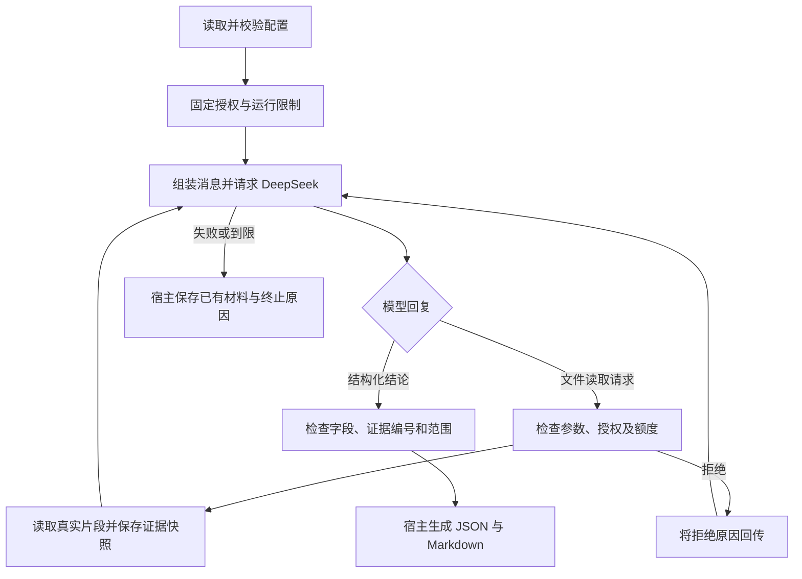

# 自行实现 Harness 的根因分析 Agent

一个独立运行的 Python Agent，用受控小型 Python 材料学习根因分析与 Harness Engineering。需求见 [规格 #1](https://github.com/Holly-Wang/root-cause-agent/issues/1)，当前实现对应 [最小闭环 #2](https://github.com/Holly-Wang/root-cause-agent/issues/2)。

DeepSeek 只提供推理。请求组装、上下文、回复解析、工具调度、授权与额度检查、证据快照、引用校验和报告生成都由本项目程序实现；运行时只使用 Python 标准库，没有 Agent 框架。

## 快速运行

需要 macOS/Linux 和 Python 3.11+，在仓库根目录运行，无需安装运行依赖。先在同一个终端提供密钥（以下是 zsh 的隐藏输入方式）：

```zsh
read -rs 'DEEPSEEK_API_KEY?粘贴 DeepSeek API Key（输入隐藏）：'
export DEEPSEEK_API_KEY
```

不要将实际密钥填写到配置或仓库中。若之前已在当前终端导出变量，可直接运行：

```bash
python3 -m rca_agent --config examples/average/config.json --output runs/average
```

程序显示进度，将 `run.json` 和 `report.md` 保存到指定目录。退出码：`0` 表示形成有效报告，`1` 表示分析未完成，`2` 表示配置或报告写入错误。报告输出目录应在授权材料目录之外。`runs/` 不进入 Git。

本次开发的模拟回归和类型检查已通过；真实 DeepSeek 验证尚待在配置了密钥的终端执行。模拟结果不能替代真实模型验收。

## 主要流程



- 模型使用原生 `read_file` 工具调用。程序解析参数并执行；模型没有任意命令执行权。
- 工具结果中的证据编号、实际文本和行范围回传给模型，模型可据此继续调查。
- 初始材料标明用户来源，不视作本次测试已经验证的事实。
- 最终候选原因必须引用实际取得的文件证据；引用有效不代表候选原因正确。报告保留支持与反驳证据、实际验证、未确认事项、修复建议和下一步；无反驳材料时明确说明。
- JSON 保存配置快照、模型名称、通信来源、模型/工具尝试计数、公开事件、实际证据与结论。Markdown 是宿主基于有效结构化结果生成的阅读版本。

## 配置及限制

配置是 JSON，包含 `question`、`initial_materials`（文本列表）、`authorized_dir`、`model` 和 `limits`。相对授权目录以配置文件所在目录为基准；启动后固定解析出的实际目录。路径越界及指向范围外的符号链接被拒绝。

| 限制 | 默认值 | 行为 |
| --- | --- | --- |
| `max_model_calls` | 8 | 每次模型请求尝试计数，到限不发起新操作 |
| `max_tool_calls` | 12 | 所有工具请求，包括非法和被拒绝的请求，均计数 |
| `total_seconds` | 120 | 基础总时限；调用前后检查，HTTP 使用剩余时间作超时 |
| `max_read_bytes` | 8192 | 单次片段的 UTF-8 字节上限，超限拒绝、不保存部分证据 |

单次读取最多 200 行，定位片段最多扫描 256 KiB。模型回复最多请求 4096 tokens，HTTP 响应最多读取 1 MiB。默认值是初版实现选择，可在后续任务调整，不代表规格预先固定的数值。

到限后已有文件证据仍保存，不额外请求模型生成结束报告。最后一个允许的模型请求可以交付有效结论，但其后不能启动新工具。无效结论或 API 故障以失败结束，本版本不重试或修正报告。

DeepSeek 接口固定为 `https://api.deepseek.com/chat/completions`，使用非流式 JSON 输出并显式关闭 thinking mode，避免将模型推理内容混入可核对的证据。模型名称由配置选择，样例为 `deepseek-flash`。接口依据：[工具调用与 thinking](https://api-docs.deepseek.com/guides/thinking_mode/)、[JSON 输出](https://api-docs.deepseek.com/guides/json_mode/)。

## 代码与测试

| 职责 | 位置 |
| --- | --- |
| 配置及固定授权 | `rca_agent/config.py` |
| 通用 HTTP 通信、模型消息协议 | `rca_agent/model.py` |
| 受限文件读取 | `rca_agent/tools.py` |
| 一次分析的循环与基础停止行为 | `rca_agent/runtime.py` |
| 证据、报告校验及报告生成 | `rca_agent/report.py` |
| CLI | `rca_agent/__main__.py` |

公共入口是 `rca_agent.run_analysis(config, transport=..., on_event=...)`。测试只替代外部模型通信，仍使用真实临时文件，从返回状态、证据、报告、事件和实际模型请求观察行为。注入的通信在结果中标为 `injected_transport`；默认真实通信标为 `deepseek`。

```bash
python3 -m unittest tests.test_analysis
```

开发依赖只有 mypy。建立 Python 虚拟环境后运行：

```bash
.venv/bin/python -m pip install -e '.[dev]'
.venv/bin/python -m mypy
.venv/bin/python -m unittest discover -s tests -v
```

本机 `python3` 别名生成的虚拟环境出现标准库路径错误；使用真实安装路径已成功创建 `.venv`：

```bash
/Users/wangxu/.local/share/uv/python/cpython-3.12-macos-aarch64-none/bin/python3.12 -m venv .venv
```

其他机器使用其有效的 Python 3.11+ 解释器创建环境。

## 当前范围

目前支持单模型、单任务、顺序文件读取与报告闭环。目录查看/搜索、许可测试、完整资源与取消控制、补充信息、有限错误恢复和五例真实评测分别由后续子任务实现。

基础时限检查及网络超时不是对任意慢响应的硬实时中断保证；完整运行中断在 #5 完善。只读取受信任的受控材料；路径检查不等同于操作系统沙箱，也不承诺防御恶意文件竞争。程序不修改被分析代码，不执行测试、不自动修复、不实现插件系统、多 Agent 或崩溃恢复。
