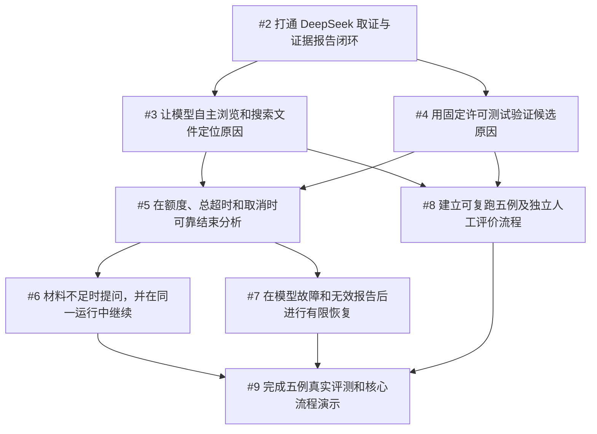

# RCA V1 开发任务

整理日期：2026-10-17。父规格：[RCA V1：自行实现核心 Harness 的根因分析 Agent](https://github.com/Holly-Wang/root-cause-agent/issues/1)。

本文件记录已确认的八项开发任务，供本地阅读、安排开发顺序和核对验收要求。T1–T8 是拆分顺序，#2–#9 是对应的 GitHub Issue 编号。

任务内容和依赖整理自 GitHub Issues。GitHub 是任务状态与变更的来源；本文件中的验收清单保留需求，不单独维护完成进度。代码实现、测试通过和真实模型验收需要分别核对，不能仅凭模拟回归关闭要求真实模型验收的任务。Issue 内容或依赖变更后，应同步更新本文件。

领域术语见 [GLOSSARY.md](../GLOSSARY.md)，架构决策见 [docs/adr](adr/)。

## 共同约束与测试边界

所有任务遵循父规格、术语表和现有 ADR：使用 Python 自行实现 Harness，DeepSeek 只提供推理，通用客户端仅负责传输；不引入 Agent 框架。确定性回归从已确认的一次分析运行公共入口观察行为，可以替代外部模型通信，取证与受控测试使用真实临时材料和进程；CLI 共用分析流程。真实模型表现与模拟回归分开记录。凭据仅通过环境变量提供，不进入样例、报告和日志。每项交付包含公开事件与必要中文说明，不承诺未完成的后续能力。

## 任务总览

| 顺序 | GitHub Issue | 交付任务 | 前置任务 |
| --- | --- | --- | --- |
| T1 | [#2](https://github.com/Holly-Wang/root-cause-agent/issues/2) | 打通 DeepSeek 取证与证据报告闭环 | 无 |
| T2 | [#3](https://github.com/Holly-Wang/root-cause-agent/issues/3) | 让模型自主浏览和搜索文件定位原因 | [#2](https://github.com/Holly-Wang/root-cause-agent/issues/2) |
| T3 | [#4](https://github.com/Holly-Wang/root-cause-agent/issues/4) | 用固定许可测试验证候选原因 | [#2](https://github.com/Holly-Wang/root-cause-agent/issues/2) |
| T4 | [#5](https://github.com/Holly-Wang/root-cause-agent/issues/5) | 在额度、总超时和取消时可靠结束分析 | [#3](https://github.com/Holly-Wang/root-cause-agent/issues/3)、[#4](https://github.com/Holly-Wang/root-cause-agent/issues/4) |
| T5 | [#6](https://github.com/Holly-Wang/root-cause-agent/issues/6) | 材料不足时提问，并在同一运行中继续 | [#5](https://github.com/Holly-Wang/root-cause-agent/issues/5) |
| T6 | [#7](https://github.com/Holly-Wang/root-cause-agent/issues/7) | 在模型故障和无效报告后进行有限恢复 | [#5](https://github.com/Holly-Wang/root-cause-agent/issues/5) |
| T7 | [#8](https://github.com/Holly-Wang/root-cause-agent/issues/8) | 建立可复跑五例及独立人工评价流程 | [#3](https://github.com/Holly-Wang/root-cause-agent/issues/3)、[#4](https://github.com/Holly-Wang/root-cause-agent/issues/4) |
| T8 | [#9](https://github.com/Holly-Wang/root-cause-agent/issues/9) | 完成五例真实评测和核心流程演示 | [#6](https://github.com/Holly-Wang/root-cause-agent/issues/6)、[#7](https://github.com/Holly-Wang/root-cause-agent/issues/7)、[#8](https://github.com/Holly-Wang/root-cause-agent/issues/8) |

## 依赖关系与推进方式

每次选择所有前置任务均已完成的任务。按 T1–T8 的顺序推进也满足依赖；文件调查和许可测试都依赖最小闭环，案例准备可在这两项完成后与运行控制的完善分别推进。

## T1：打通 DeepSeek 取证与证据报告闭环

GitHub：[#2](https://github.com/Holly-Wang/root-cause-agent/issues/2)。前置任务：无，可立即开始。

### 交付行为

用户通过 CLI 和配置对一个受控 Python 开发材料启动分析，DeepSeek 自主请求读取文件片段，宿主执行并回传真实结果；模型可以继续调查并提交结构化结论，宿主检查后输出 JSON 和 Markdown 报告。这是可独立演示的最小 Agent。

### 验收条件

- [ ] 建立可独立启动的 Python 程序及已确认公共分析入口；配置包含问题、初始材料、授权目录、模型与基础运行限制，非法配置在模型调用前拒绝。
- [ ] 程序自行组织请求与上下文、解析回复、顺序调度工具和保存状态；真实 DeepSeek 请求不委托 Agent 框架，具体版本可配置并记录。
- [ ] 提供文件片段读取：校验参数及实际路径，拒绝越界和指向范围外的符号链接；保存内容快照、来源、行号范围及本次证据编号，初始材料另标来源。
- [ ] 至少一次真实模型运行取得文件内容，将真实工具反馈回传模型后形成报告；模型能根据结果继续行动，调查顺序和答案不写成案例专用脚本。
- [ ] 宿主校验结论字段、证据编号和引用范围后生成 JSON/Markdown；报告包含原因判断或候选、支持与反驳材料、实际验证、未确认事项、修复建议及下一步。不存在反驳材料时如实注明，不制造内容。
- [ ] 最小运行已有模型/工具尝试次数上限、总时限和读取返回上限；到限停止新操作，宿主保存已有材料。失败或无效结论不标为分析完成；完整限制和恢复行为由后续任务完善。
- [ ] 公共入口的确定性回归覆盖模型请求真实文件、工具结果回传、报告引用和拒绝越界；建立必要开发命令与进度展示，记录真实运行与模拟回归的区别。

## T2：让模型自主浏览和搜索文件定位原因

GitHub：[#3](https://github.com/Holly-Wang/root-cause-agent/issues/3)。前置任务：[#2](https://github.com/Holly-Wang/root-cause-agent/issues/2)。

### 交付行为

用户仅提供问题及故障材料，模型通过目录查看、文本搜索和片段读取找到相关文件，并在后续判断和报告中使用实际取得的证据。

### 验收条件

- [ ] 在既有循环中增加目录查看和文本搜索，与片段读取组成三种文件取证工具；调查动作由模型根据材料与反馈选择。
- [ ] 三种工具均校验参数和实际目标范围，拒绝路径越界与外部符号链接；拒绝原因返回模型，模型可在剩余额度内调整。
- [ ] 明确结果条数、读取及返回内容上限，向模型和报告标明截断或拒绝；未取得或未保留的内容不能被当成有效证据。
- [ ] 保存各工具实际取得的内容及来源、范围和编号；取得后的源文件变化不改变既有证据快照，报告引用可被核对。
- [ ] 公共入口回归以真实临时目录验证浏览、搜索、读取、反馈和报告的完整调查路径，同时覆盖非法参数、越界、工具故障及受限输出；不绑定固定的内部调用顺序。

## T3：用固定许可测试验证候选原因

GitHub：[#4](https://github.com/Holly-Wang/root-cause-agent/issues/4)。前置任务：[#2](https://github.com/Holly-Wang/root-cause-agent/issues/2)。

### 交付行为

用户在启动配置中许可明确的测试调用；模型选择测试编号，程序启动真实受控测试，将结果回传模型并用于证据报告。

### 验收条件

- [ ] 启动时验证并固定许可测试的完整程序和参数；模型只能提交测试编号，宿主按固定映射执行，不将模型文字拼接成 shell 命令。
- [ ] 未许可测试、非法参数和运行中改写命令请求被拒绝，原因返回模型且不启动进程；许可内容不会被模型输出改变。
- [ ] 记录真实测试编号、输出、退出状态及证据编号；区别测试断言失败、启动/执行工具故障与未验证假设，并在模型反馈与报告中保留区别。
- [ ] 输出有界；每个测试在独立进程组运行，达到测试自身时限时终止、必要时强制结束并确认退出，不能确认则记录清理失败，清理宽限最多两秒。
- [ ] 公共入口使用真实受控进程验证测试成功、断言失败、无法启动、未经许可拒绝和测试自身超时；报告能引用实际测试材料，说明可信测试不具备操作系统沙箱隔离。

## T4：在额度、总超时和取消时可靠结束分析

GitHub：[#5](https://github.com/Holly-Wang/root-cause-agent/issues/5)。前置任务：[#3](https://github.com/Holly-Wang/root-cause-agent/issues/3)、[#4](https://github.com/Holly-Wang/root-cause-agent/issues/4)。

### 交付行为

用户为一次分析配置完整资源限制，或在运行中取消；程序停止新操作，清理正在执行的许可测试，保存调查进展与准确的终止原因。

### 验收条件

- [ ] 完整验证和执行模型/工具次数、读取及输出规模、上下文规模、总时限和测试时限配置；区分单次结果限制与导致运行停止的累计限额，明确受限行为，不静默无限积累材料。
- [ ] 每次模型请求尝试均计数，每个工具请求包括非法和被拒绝请求均计数；为后续重试及报告修正复用同一计数与期限控制。
- [ ] 达到任一运行限额后不再发起新模型/工具操作，也不增加用于结束报告的模型请求；在模型通信等待和工具执行过程中同样响应总超时及取消。
- [ ] 公共入口与 CLI 的取消动作均停止分析；取消、总超时或测试自身超时时，终止相应测试进程组，必要时强制清理并确认结果。分析停止后的清理宽限最多两秒，实际耗时和清理失败照实记录。
- [ ] 最终运行状态区分分析完成、额度耗尽、超时、用户取消和系统失败；诊断结论单独记录，所有终止路径保存已有证据、关键事件及未完成原因。
- [ ] 公共入口回归覆盖拒绝请求耗尽额度、上下文/累计材料限额、模型通信等待超时、运行中取消、执行测试时总超时和清理失败记录，验证到限后没有额外模型操作。

## T5：材料不足时提问，并在同一运行中继续

GitHub：[#6](https://github.com/Holly-Wang/root-cause-agent/issues/6)。前置任务：[#5](https://github.com/Holly-Wang/root-cause-agent/issues/5)。

### 交付行为

模型指出关键材料缺口，在终端向用户请求补充；程序暂停模型调用，收到文本或授权范围内材料后利用已有证据继续分析。

### 验收条件

- [ ] 模型可返回明确的信息缺口和合理补充请求，CLI 显示问题并进入等待；等待期间不调用模型，总时限继续计算。
- [ ] 接受补充文本或授权目录内材料引用，校验并标明来源后在同一进程和分析运行中继续；用户描述不冒充本次测试已验证结果。
- [ ] 启动时的授权目录、许可测试及运行限制保持固定；补充文本和引用不能扩权，若需扩权，明确要求修改配置后重新启动。
- [ ] 等待阶段的超时和取消沿用既有终止、保存与清理流程；材料不足也可以作为带缺口及补充请求的完成报告，完成不等于诊断正确。
- [ ] 公共入口回归覆盖补充后继续、等待时无模型调用、等待时间计入总时限、等待取消及非法/越界补充拒绝；CLI 进行少量共用流程的输入验证。

## T6：在模型故障和无效报告后进行有限恢复

GitHub：[#7](https://github.com/Holly-Wang/root-cause-agent/issues/7)。前置任务：[#5](https://github.com/Holly-Wang/root-cause-agent/issues/5)。

### 交付行为

一次暂时性模型服务故障或无效结构化结论发生后，程序在剩余额度和时间允许时进行一次恢复；成功则交付有效报告，失败则保存材料并准确结束。

### 验收条件

- [ ] 明确暂时性模型服务错误的判定，最多重试一次；不将配置、凭据或其它非暂时性故障无限重试，最终失败单独记录。
- [ ] 结构化结论字段不合法、引用编号不存在或引用范围无效时最多请求模型修正一次，向模型提供具体校验问题；仍无效则系统失败，保留证据而不把无效报告标为分析完成。
- [ ] 重试及修正尝试计入实际模型调用额度；额度或时限不足时不恢复，沿用宿主结束保存流程，不发起额外结束请求。
- [ ] 成功报告由宿主生成；引用有效与诊断正确分开表达。候选原因、反驳材料和未确认事项按实际材料输出，不因结构校验通过而声称已证明根因。
- [ ] 公共入口使用受控模型响应回归暂时故障恢复/持续故障、无效格式修正、非法引用修正、修正仍失败和恢复前额度耗尽，观察最终状态、报告及公开事件。

## T7：建立可复跑五例及独立人工评价流程

GitHub：[#8](https://github.com/Holly-Wang/root-cause-agent/issues/8)。前置任务：[#3](https://github.com/Holly-Wang/root-cause-agent/issues/3)、[#4](https://github.com/Holly-Wang/root-cause-agent/issues/4)。

### 交付行为

评测者可以用固定输入运行三个开发案例，取得独立可评分的分析记录；两个留出案例及评价依据提前固定，为最终真实评测做好准备。

### 验收条件

- [ ] 建立五个受控小型 Python 案例：三个开发案例、两个留出案例，其中一个留出案例材料不足；各案例给出问题、初始材料、授权及必要许可测试，能复现预设故障或明确的信息缺口。
- [ ] 案例答案及人工评价依据位于应用模型和取证工具不可读取的范围；授予的是单个案例材料范围，不能通过搜索或符号链接取得评价答案。
- [ ] 两个留出案例在最终评测前冻结材料、配置和评分依据，并记录固定版本；准备时允许人工及确定性检查，不用真实 Agent 调查留出案例来调整提示词或逻辑。
- [ ] 通过已有分析入口实际运行开发案例，生成关联配置、模型版本、证据、报告、事件和终止原因的记录；提供独立人工评分方式，诊断正确性与运行完成分别评价。
- [ ] 真实模型运行与模拟回归分开存放或清楚标识，不预置 Agent 答案，不将运行成功自动记为诊断正确；失败结果照实保留。
- [ ] 中文说明能让评测者复跑开发案例并完成一次独立评分，解释最终四个充分材料案例至少三个正确定位、材料不足案例指出缺口及合理问题的验收标准；完整五例真实成绩留到最终任务。

## T8：完成五例真实评测和核心流程演示

GitHub：[#9](https://github.com/Holly-Wang/root-cause-agent/issues/9)。前置任务：[#6](https://github.com/Holly-Wang/root-cause-agent/issues/6)、[#7](https://github.com/Holly-Wang/root-cause-agent/issues/7)、[#8](https://github.com/Holly-Wang/root-cause-agent/issues/8)。

### 交付行为

开发者使用完整 Agent 完成五例真实 DeepSeek 评测，人工核对表现，并交付可复跑记录、五分钟演示和十分钟设计说明。

### 验收条件

- [ ] 完成已有确定性回归及少量 CLI 入口验证，分别记录结果，不能用模拟模型表现替代真实诊断成绩。
- [ ] 三个开发案例和两个已冻结留出案例各至少进行一次最终真实 DeepSeek 运行并人工评价；记录输入配置、案例固定版本、模型版本、关键事件、终止原因、诊断结果和评价依据。
- [ ] 四个材料充分案例至少三个正确定位预设故障原因；材料不足案例指出关键缺口及合理补充请求，若用户停止补充，记录实际终止原因。保留所有最终失败和错误记录。
- [ ] 不根据留出案例调整提示词或分析逻辑后仍宣称原有留出评测有效；未达到标准时如实报告未通过及原因，不通过删改失败记录包装成绩。
- [ ] 提供五分钟演示及十分钟设计说明材料，能逐步解释请求、上下文、调度、取证、引用、授权、限制、状态与评测如何由项目程序实现，以及主要取舍和未覆盖边缘。
- [ ] 中文开发、运行和配置说明与实际可运行命令一致，凭据以环境变量提供；五例成绩只说明初版案例表现，不宣称普遍诊断准确率。
